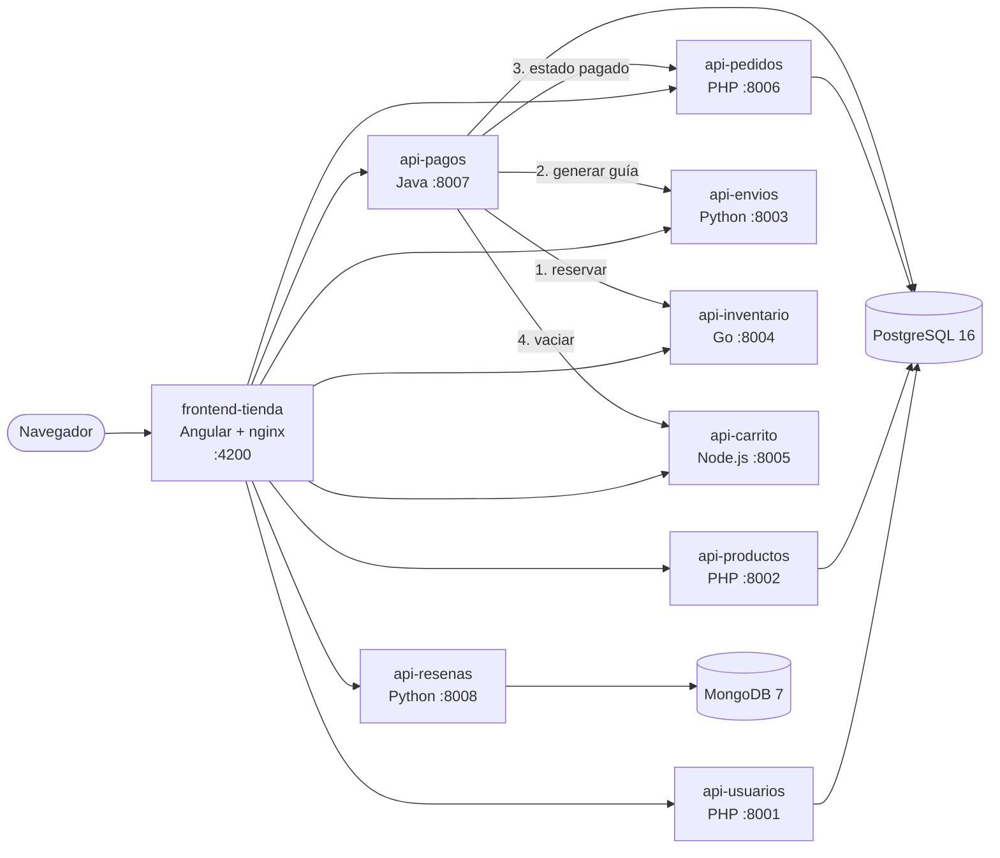
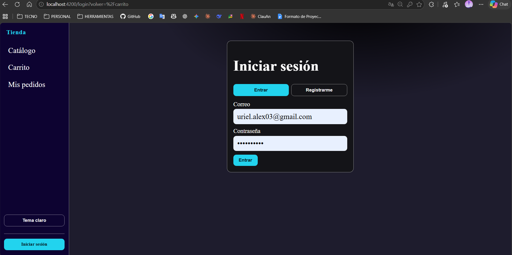
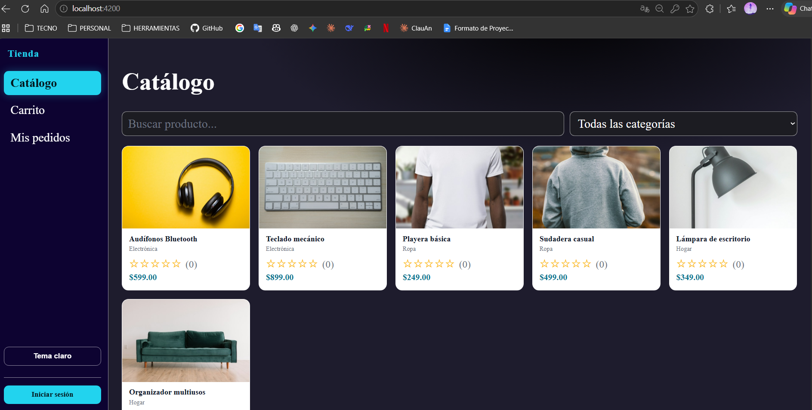
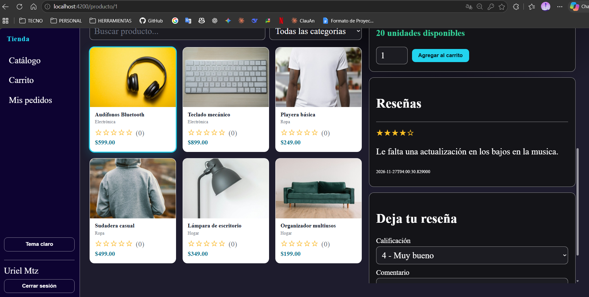
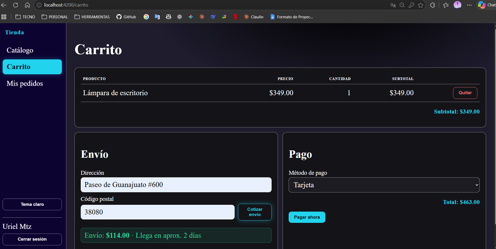
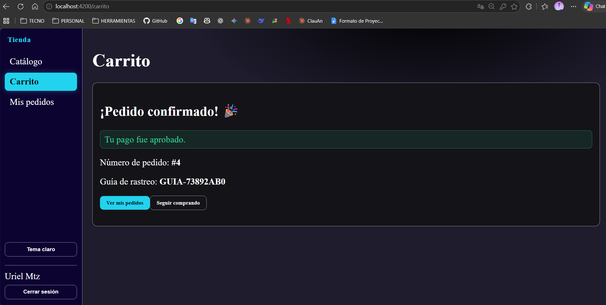
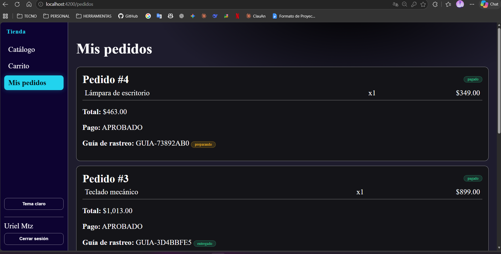
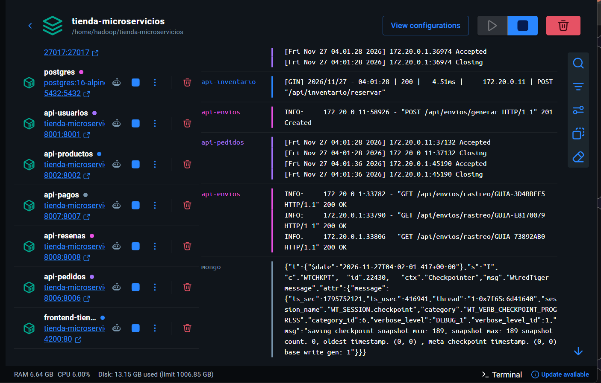

# Tienda Microservicios (DJRU)

Plataforma de comercio electrónico construida con una **arquitectura de microservicios multi-stack**: 8 APIs independientes, cada una con su propio lenguaje, base de datos y contenedor, más un frontend en Angular que las consume. Todo el ecosistema se orquesta con **Docker Compose** dentro de la red interna `red-tienda`.

## Integrantes

| Integrante | Responsabilidad |
|---|---|
| Diego Ramírez Vázquez | api-usuarios, api-productos, api-pedidos (PHP + PostgreSQL) |
| Jacqueline | frontend-tienda (Angular), api-carrito (Node.js) |
| Rafael Barranco Mendoza | api-envios, api-resenas (Python), api-inventario (Go) |
| Uriel Alejandro Martínez Martínez | api-pagos (Java + PostgreSQL), docker-compose, integración y pruebas |

## Arquitectura



- El **navegador** llama a cada API por `localhost:<puerto>`, por eso todas tienen CORS habilitado.
- Entre servicios se llaman por **nombre de contenedor** dentro de `red-tienda` (por ejemplo `http://api-inventario:8004`).
- **api-pagos** es el orquestador del cierre de compra: al aprobar un pago reserva inventario, genera la guía de envío, marca el pedido como pagado y vacía el carrito.

## Servicios

| # | Servicio | Tecnología | Datos | Puerto |
|---|---|---|---|---|
| 1 | api-usuarios | PHP 8.3 + JWT (firebase/php-jwt) | PostgreSQL `usuarios_db` | 8001 |
| 2 | api-productos | PHP 8.3 | PostgreSQL `productos_db` | 8002 |
| 3 | api-envios | Python 3.12 + FastAPI | Memoria | 8003 |
| 4 | api-inventario | Go + Gin | Memoria | 8004 |
| 5 | api-carrito | Node.js 20 + Express | Memoria | 8005 |
| 6 | api-pedidos | PHP 8.3 | PostgreSQL `pedidos_db` | 8006 |
| 7 | api-pagos | Java 21 + Spring Boot 4.2 + JPA | PostgreSQL `pagos_db` | 8007 |
| 8 | api-resenas | Python 3.12 + FastAPI + PyMongo | MongoDB `resenas_db` | 8008 |
| 9 | frontend-tienda | Angular 22 + nginx | — | 4200 |
| — | postgres | PostgreSQL 16 | 4 bases de datos | 5432 |
| — | mongo | MongoDB 7 | `resenas_db` | 27017 |

## Estructura del repositorio

```
tienda-microservicios/
├── docker-compose.yml
├── README.md
├── db/init/                # Scripts SQL que crean las BD y tablas al iniciar PostgreSQL
├── pruebas/flujo.sh        # Caso de prueba completo con curl
├── api-usuarios/           # PHP + Dockerfile
├── api-productos/          # PHP + Dockerfile
├── api-envios/             # Python + Dockerfile
├── api-inventario/         # Go + Dockerfile
├── api-carrito/            # Node.js + Dockerfile
├── api-pedidos/            # PHP + PostgreSQL + Dockerfile
├── api-pagos/              # Java + PostgreSQL + Dockerfile
├── api-resenas/            # Python + MongoDB + Dockerfile
└── frontend-tienda/        # Angular + Dockerfile (nginx)
```

## Cómo levantar el proyecto

**Requisitos:** Docker y Docker Compose v2 (Docker Desktop en Windows con integración WSL, o Docker Engine en Linux).

```bash
git clone https://github.com/Milhouse22-uri/tienda-microservicios-DJRU.git tienda-microservicios
cd tienda-microservicios
docker compose up -d --build
docker compose ps
```

El primer build tarda entre 5 y 10 minutos. Cuando los 11 contenedores estén en `Up` (y `postgres` en `healthy`):

- **Tienda:** http://localhost:4200
- **APIs:** http://localhost:8001 a http://localhost:8008 (cada una responde `GET /health`)

Para reiniciar desde cero (borra los datos de PostgreSQL y MongoDB):

```bash
docker compose down -v
docker compose up -d
```

## Formato de respuesta común

Todas las APIs responden JSON con el mismo formato y códigos HTTP estándar (200, 201, 400, 404, 500):

```json
{ "ok": true,  "data": { } }
{ "ok": false, "error": "mensaje" }
```

## Endpoints

### 1. API de Usuarios (8001)

| Método | Endpoint | Recibe | Respuesta |
|---|---|---|---|
| GET | `/health` | — | `200` servicio activo |
| POST | `/api/usuarios/registro` | `nombre`, `correo`, `contrasena` (mínimo 8 caracteres) | `201` usuario creado. `400` datos faltantes, contraseña corta o correo repetido |
| POST | `/api/usuarios/login` | `correo`, `contrasena` | `200` `{ token, usuario }` con JWT HS256. `401` credenciales incorrectas |
| GET | `/api/usuarios/{id}` | — | `200` perfil del usuario. `404` no encontrado |

### 2. API de Productos (8002)

| Método | Endpoint | Recibe | Respuesta |
|---|---|---|---|
| GET | `/health` | — | `200` servicio activo |
| GET | `/api/productos` | Opcionales `?q=` (búsqueda) y `?categoria=` | `200` lista de productos |
| GET | `/api/productos/{id}` | — | `200` detalle del producto. `404` no encontrado |
| POST | `/api/productos` | `nombre`, `descripcion`, `precio`, `categoria`, `imagen_url` | `201` producto creado. `400` datos inválidos |

### 3. API de Envíos (8003)

| Método | Endpoint | Recibe | Respuesta |
|---|---|---|---|
| GET | `/health` | — | `200` servicio activo |
| POST | `/api/envios/cotizar` | `codigo_postal` (5 dígitos), `cantidad` | `200` `{ costo_envio, dias_estimados }`. `400` CP inválido |
| POST | `/api/envios/generar` | `pedido_id` | `201` `{ guia, pedido_id, estado }` con guía `GUIA-XXXXXXXX` |
| GET | `/api/envios/rastreo/{guia}` | — | `200` `{ guia, pedido_id, estado, creado_en }`. `404` guía no encontrada |

- Tarifa: `99 + 15 × cantidad`. CP que empieza con `38` (Guanajuato): 2 días; otro CP: 5 días y +$50.
- Estado por tiempo desde la generación: `preparando` (< 2 min), `en_transito` (< 5 min), `entregado`.

### 4. API de Inventario (8004)

| Método | Endpoint | Recibe | Respuesta |
|---|---|---|---|
| GET | `/health` | — | `200` servicio activo |
| GET | `/api/inventario/{producto_id}` | — | `200` `{ producto_id, disponibles }`. `404` no existe |
| POST | `/api/inventario/reservar` | `items: [{ producto_id, cantidad }]` | `200` stock actualizado. `400` stock insuficiente (no descuenta nada). `404` producto inexistente |
| POST | `/api/inventario/reabastecer` | `producto_id`, `cantidad` | `200` stock actualizado. `400` cantidad inválida |

Stock inicial: producto 1 → 20, 2 → 15, 3 → 10, 4 → 25, 5 → 8, 6 → 12.

### 5. API de Carrito (8005)

| Método | Endpoint | Recibe | Respuesta |
|---|---|---|---|
| GET | `/health` | — | `200` servicio activo |
| GET | `/api/carrito/{usuario_id}` | — | `200` `{ usuario_id, items, total }` |
| POST | `/api/carrito/{usuario_id}/agregar` | `producto_id`, `nombre`, `precio`, `cantidad` | `200` carrito actualizado (suma cantidad si ya existe). `400` datos inválidos |
| DELETE | `/api/carrito/{usuario_id}/item/{producto_id}` | — | `200` carrito actualizado. `404` el producto no está en el carrito |
| DELETE | `/api/carrito/{usuario_id}/vaciar` | — | `200` carrito vacío |

### 6. API de Pedidos (8006)

| Método | Endpoint | Recibe | Respuesta |
|---|---|---|---|
| GET | `/health` | — | `200` servicio activo |
| POST | `/api/pedidos` | `usuario_id`, `direccion`, `codigo_postal`, `costo_envio`, `items: [{ producto_id, nombre, cantidad, precio_unitario }]` | `201` pedido con `subtotal`, `total` y estado `pendiente`. `400` datos inválidos |
| GET | `/api/pedidos/usuario/{usuario_id}` | — | `200` historial del usuario con sus artículos |
| PATCH | `/api/pedidos/{id}/estado` | `estado` (`pendiente`, `pagado`, `enviado`, `cancelado`), `guia` opcional | `200` pedido actualizado. `400` estado no permitido. `404` no encontrado |

### 7. API de Pagos (8007)

| Método | Endpoint | Recibe | Respuesta |
|---|---|---|---|
| GET | `/health` | — | `200` servicio activo |
| POST | `/api/pagos/procesar` | `pedido_id`, `usuario_id`, `monto`, `metodo_pago`, `items: [{ producto_id, cantidad }]` | `201` pago `APROBADO` con `guia`. `200` pago `RECHAZADO` con `motivo`. `400` datos faltantes o sin existencias |
| GET | `/api/pagos/pedido/{pedido_id}` | — | `200` comprobante del pago. `404` sin pagos |

- Simulación de pasarela: se rechaza si `metodo_pago` es `tarjeta_rechazada` o si `monto > 50000`.
- Al aprobar, en este orden: reserva en inventario → genera guía en envíos → marca el pedido como `pagado` con la guía → vacía el carrito.

### 8. API de Reseñas (8008)

| Método | Endpoint | Recibe | Respuesta |
|---|---|---|---|
| GET | `/health` | — | `200` servicio activo |
| GET | `/api/resenas/producto/{producto_id}` | — | `200` `{ promedio, total, resenas }` (más recientes primero) |
| POST | `/api/resenas` | `producto_id`, `usuario_id`, `calificacion` (1 a 5), `comentario` | `201` reseña guardada en MongoDB. `400` calificación fuera de rango |
| GET | `/api/resenas/promedios` | — | `200` `[{ producto_id, promedio, total }]` para el catálogo |

## Aplicación web (frontend-tienda)

| Vista | Ruta | Qué hace | APIs que usa |
|---|---|---|---|
| Login / Registro | `/login` | Alta de usuario e inicio de sesión con JWT | usuarios |
| Inicio / Catálogo | `/` | Cuadrícula con buscador, filtro por categoría y calificación promedio | productos, reseñas |
| Detalle de producto | `/producto/:id` (ruta hija del catálogo) | Información completa, disponibilidad en tiempo real, reseñas y formulario para comentar | productos, inventario, reseñas, carrito |
| Carrito y checkout | `/carrito` | Resumen, cotizador por código postal (solo 5 dígitos), simulación de pago y confirmación | carrito, envíos, pedidos, pagos |
| Mis pedidos | `/pedidos` | Historial con estado del pedido, estado del pago y guía de rastreo | pedidos, pagos, envíos |

- Las rutas `/carrito` y `/pedidos` están protegidas: sin sesión redirigen a `/login`.
- Tema **oscuro / claro** seleccionable desde la barra superior (se recuerda en el navegador).
- Los servicios del frontend tienen un modo `mock` en `src/environments/environment.ts` para desarrollar sin backend; en la entrega todos están en `false` y se consumen las APIs reales.

## Caso de prueba completo

### Desde la terminal

```bash
./pruebas/flujo.sh
```

El script registra un usuario, inicia sesión, consulta catálogo, stock y reseñas, agrega al carrito, cotiza el envío, crea el pedido y lo paga. Resultado esperado:

- Pago `APROBADO` con guía `GUIA-XXXXXXXX`.
- Stock del producto 1: de 20 a 18.
- Carrito vacío.
- Pedido en estado `pagado` con la misma guía.

### Desde el navegador

1. Registrarse e iniciar sesión en http://localhost:4200.
2. Buscar y filtrar productos en el catálogo.
3. Abrir un producto, revisar disponibilidad y dejar una reseña.
4. Agregar al carrito, cotizar con el CP `38010` y pagar con `tarjeta`.
5. Revisar en **Mis pedidos** el estado `pagado` y la guía.
6. Repetir con `tarjeta_rechazada` para ver el rechazo (el pedido queda `pendiente` y el stock no cambia).

## Capturas


| Vista | Captura |
|---|---|
| Login / Registro |  |
| Catálogo |  |
| Detalle con reseñas |  |
| Carrito y cotización |  |
| Confirmación de pago |  |
| Mis pedidos |  |
| Contenedores |  |

## Decisiones técnicas

- **Una sola instancia de PostgreSQL con 4 bases de datos** (una por servicio) para mantener el aislamiento de datos sin multiplicar contenedores. Las bases y tablas se crean con los scripts de `db/init/`.
- **Envíos, inventario y carrito guardan datos en memoria**: su información es temporal o de demostración, y se reinicia al recrear el contenedor.
- **api-pagos orquesta el cierre de compra** para que el frontend no tenga que coordinar cuatro servicios y el flujo quede en el backend.
- **El cliente HTTP de api-pagos usa HTTP/1.1** porque uvicorn (api-envios) no aceptaba el cuerpo de las peticiones con la negociación HTTP/2 por defecto de Java.
- **`JWT_SECRET` de 32 o más caracteres**: la versión actual de `firebase/php-jwt` rechaza claves más cortas para HS256.
